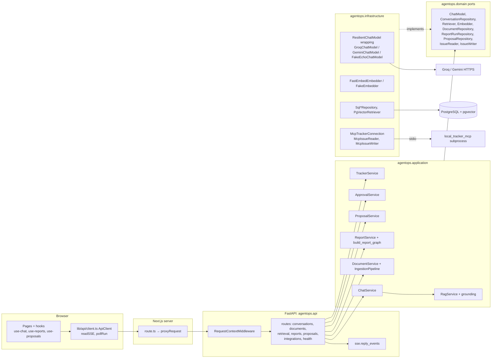
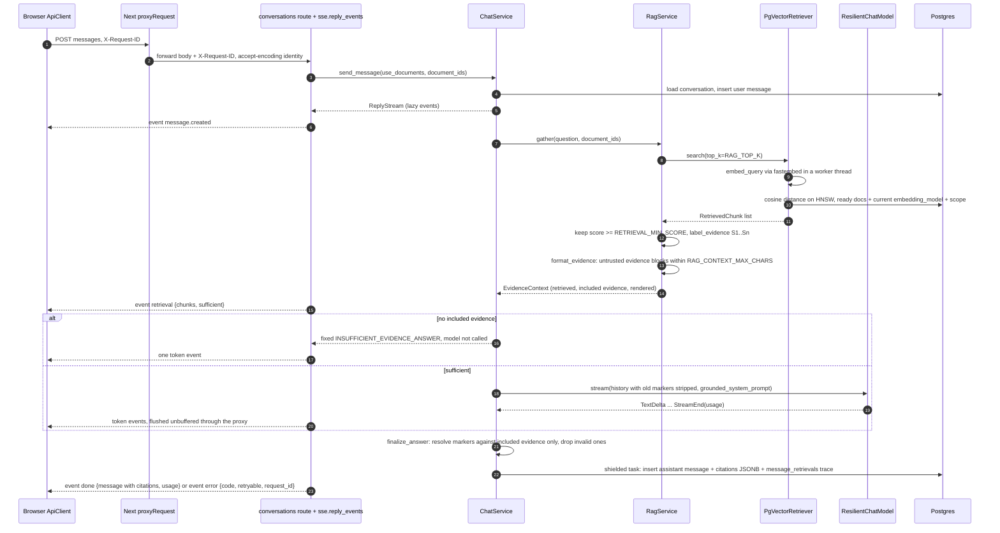
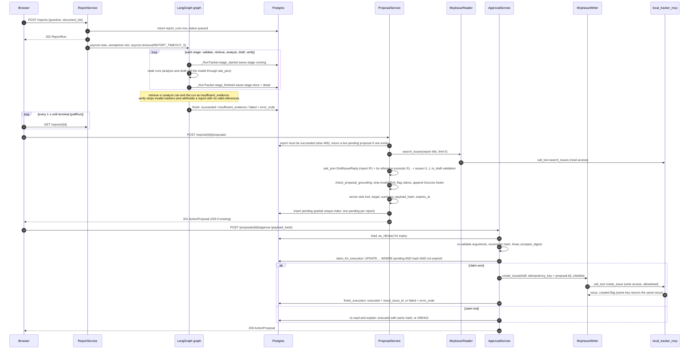
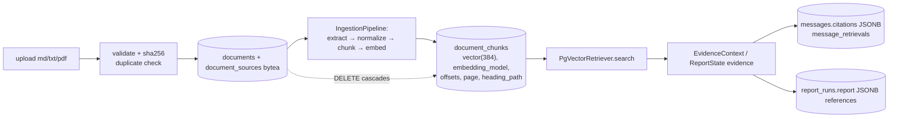
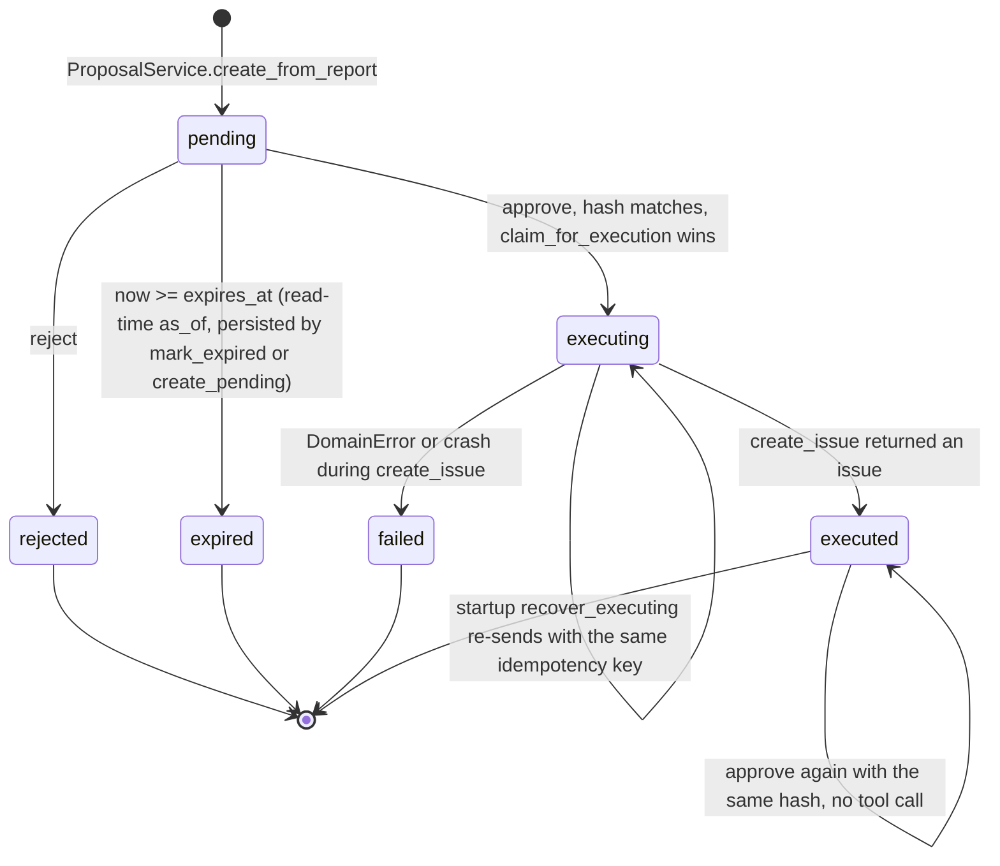

# Architecture

AgentOps is a single-user, locally run app with three features: chat grounded in uploaded documents with
server-resolved citations, a bounded LangGraph report workflow, and a human approval gate for the one write
action (creating an issue in a local MCP tracker). The browser only talks to the Next.js server. Next.js proxies
`/api/v1/*` to one FastAPI process, and that process does all the work. It stores everything in PostgreSQL with
pgvector, computes embeddings locally with fastembed (ONNX, CPU), calls one LLM provider over HTTPS (Groq by
default, or Gemini), and runs the `local-tracker` MCP server as a stdio subprocess. There is no queue, worker,
cache or second datastore. Related docs: [API contract](api-contract.md), [security](security.md),
[evaluation](evaluation.md), [implementation status](implementation-status.md), and the ADRs in [adr/](adr/).

| process | runs | talks to |
|---|---|---|
| Browser | React pages under `frontend/src/app/` (`/`, `/documents`, `/reports`, `/approvals`, `/tracker`) | same-origin `/api/v1/*` only (CSP `connect-src 'self'`) |
| Next.js server | `app/api/v1/[...path]/route.ts` → `lib/server/proxy.ts` (`proxyRequest`) | FastAPI at `BACKEND_URL` (server-only env, default `http://localhost:8000`) |
| FastAPI (`agentops.main:app_factory`) | API, application services, background report tasks, fastembed in worker threads | Postgres (asyncpg), LLM provider (HTTPS), MCP subprocess (stdio JSON-RPC) |
| `python -m local_tracker_mcp` | MCP server with a JSON-file store in `MCP_TRACKER_DATA_DIR` | nothing (an audit hook blocks network, subprocesses and writes outside its data dir) |
| PostgreSQL 17 + pgvector | `pgvector/pgvector:pg17` (`docker-compose.yml` runs only the DB, on port 5433) | — |

## Components

Composition happens in three places: `main.build_dependencies`, `documents_wiring.build_document_components` and
`tracker_wiring.build_tracker_components`. They build one `AppDependencies` per process in the FastAPI lifespan.
Routes resolve services from it through `api/dependencies.py`.

## RAG chat request

`POST /api/v1/conversations/{id}/messages` with `use_documents: true`.

Notes that the diagram can't show:

- The label → chunk mapping exists only in the `EvidenceContext` of this request. A label that was budgeted out,
  invented by the model or written inside a document never becomes a citation (`grounding.resolve_citations`).
  Delimiter look-alikes inside documents are replaced with `[removed tag]` (`format_untrusted_block`).
- If the model streams text but cites nothing valid, the message is stored with
  `grounding: insufficient_evidence` and the text is kept.
- If the client disconnects, `reply_events` closes the reply under `anyio.CancelScope(shield=True)`, and the
  partial answer is stored as `incomplete` (or `failed`) with `error_code: cancelled`.

## Report workflow, follow-up proposal and approval

The report graph (`application/reports/graph.py`) has no cycles. It runs
`START → validate → retrieve → analyze → draft → verify → END`, with conditional exits to `END` after `retrieve`
and after `analyze` when `insufficient` is set. Nodes never touch persistence: the `_tracked` wrapper calls the
`StageTracker` protocol, which `ReportService._RunTracker` implements. There is no LangGraph checkpointer.

Proposal drafting gets the same kind of deterministic check as the report's `verify` node
([ADR 0008](adr/0008-deterministic-grounding-check-for-proposals.md)). The model sees the report's stored
reference excerpts under their `S1..` labels and must cite them. `check_proposal_grounding` then strips invalid
markers and flags each claim that is `unsupported`, `unverified_number` or `low_overlap`. The server appends a
"Sources" footer, which is part of the hashed arguments. The `grounding` result is stored on the proposal for the
reviewer and is **not** hashed: it is advisory, and the human still decides.

## Module responsibilities and dependency direction

| layer | package | owns | may import |
|---|---|---|---|
| domain | `agentops/domain/` | dataclasses, enums, `DomainError` codes, `Protocol` ports (`ports.py`, `retrieval.py`, `documents.py`, `reports.py`, `proposals.py`, `tracker.py`), `payload_hash` | stdlib only |
| application | `agentops/application/` | use cases: `ChatService`, `RagService`, `grounding`, `documents/` (validation, normalize, chunking, pipeline, service), `reports/` (graph, nodes, parsing, prompts, service), `proposals/` (drafting, approval, arguments, grounding), `TrackerService` | domain, langgraph, pydantic |
| infrastructure | `agentops/infrastructure/` | adapters: `db/` (SQLAlchemy rows, `Sql*Repository`, `PgVectorRetriever`), `llm/` (provider adapters + `resilience.py`), `embeddings/`, `documents/extraction.py`, `mcp/tracker.py`, `logging.py` | domain, SDKs |
| api | `agentops/api/` | routes, Pydantic schemas, SSE framing, error envelope, request-id middleware | application, domain |
| composition | `main.py`, `documents_wiring.py`, `tracker_wiring.py`, `config.py` | build adapters from `Settings` and inject them | everything |
| MCP server | `src/local_tracker_mcp/` | `server.py` (tools), `store.py` (JSON file + `flock`), `sandbox.py` (PEP 578 audit hook) | `mcp`, stdlib; never `agentops` |

The direction is `api → application → domain ← infrastructure`, with wiring at the edge. On the current tree,
`domain/` imports nothing from `agentops`, and `application/` imports nothing from `infrastructure`, `api` or
`config`. **This general layering is kept by convention, review and mypy. No import-linter or test enforces it.**
The one boundary with a test is the write capability. `tests/unit/test_write_boundary.py` walks the AST of every
module under `src/agentops` and checks four things:

- `test_only_the_approval_service_and_its_wiring_touch_the_writer`: `IssueWriter`/`McpIssueWriter` are named only
  in the port, the adapter, `tracker_wiring.py` and `approval.py`.
- `test_create_issue_is_only_called_by_the_approval_service`: the only `.create_issue(...)` call site is
  `application/proposals/approval.py`.
- `test_wiring_gives_the_writer_only_to_the_approval_service`: `McpIssueWriter(...)` is passed as an argument
  exactly once, to `ApprovalService`.
- `test_read_side_services_cannot_receive_a_writer`: `ProposalService` and `TrackerService` have no writer
  parameter, and `McpIssueReader` has no `create_issue`.

## Data lifecycle

- **Documents.** The status goes `pending → processing → ready | failed` (`DocumentStatus`). Ingestion runs
  synchronously inside the upload request. An upload with identical bytes (same `checksum_sha256`) is a duplicate
  (`X-Duplicate: true`) or, if the stored document failed, a retry. The original bytes stay in `document_sources`,
  so `POST /documents/{id}/retry` re-runs `IngestionPipeline.run(document_id)`.
- **Chunks.** Markdown is split at headings and windowed to `CHUNK_MAX_CHARS` (500) with up to
  `CHUNK_OVERLAP_CHARS` (80) of overlap. The nearest heading is prepended to the embedding input only
  (`embedding_input`). `save_chunks` stores chunks with `embedding_model`, and retrieval only compares chunks of the
  current model. HNSW index: `vector_cosine_ops`, m=16, ef_construction=64, and each query runs with
  `SET LOCAL hnsw.iterative_scan = strict_order`.
- **Citations are snapshots.** `messages.citations` and `report_runs.report.references` store the marker, chunk and
  document ids, title, an excerpt of at most 300 chars and the location. `message_retrievals` stores the trace: all
  retrieved chunks as excerpts, cited ids, `top_k`, `min_score` and the model. Deleting a document is a hard delete
  that cascades to its sources and chunks. Citations survive, and `document_deleted` is computed on read from
  whether the chunk still exists. Tests: `test_citations_and_trace_survive_document_deletion` (integration) and
  `test_citations_survive_document_deletion`.
- **Report runs.** One `report_runs` row holds the question, `document_ids`, status, all five `stages` (JSONB, saved
  on every transition), `report` (JSONB, only when succeeded), `error_code` and `model`. When a run ends, a running
  stage becomes `failed` and pending stages become `skipped` (`close_stages`).
- **Proposals.** These are `action_proposals` rows. A partial unique index allows one `pending` row per
  `source_id`, and a check constraint requires `executed` to have a `result_issue_id`. Every safety-relevant
  transition is a single conditional `UPDATE`.

## Failure, retry, timeout and approval boundaries

Every bound below is in code. The configurable ones are `Settings` fields in `config.py`, set through env vars
with the same names in upper case.

| boundary | where | values (defaults) |
|---|---|---|
| LLM retries and timeouts (**the only layer**) | `infrastructure/llm/resilience.py` `ResilientChatModel`, built by `llm/factory.py` | `LLM_TIMEOUT_S`=30 as an inactivity timeout before the first chunk and between chunks; `LLM_MAX_RETRIES`=2; backoff 0.5 s base, 8 s cap, jitter in [ceiling/2, ceiling]; honours `Retry-After` up to 10 s, otherwise the error surfaces with `retry_after_s`. Never retries after the first `TextDelta` or on non-retryable errors (auth, rejected request). SDK retries are off (`max_retries=0` for openai, `HttpRetryOptions(attempts=1)` for google-genai) |
| LLM output | adapters | `LLM_MAX_OUTPUT_TOKENS`=2048 |
| No provider fallback | `build_chat_model` | missing key → `None` → `503 llm_not_configured`. There is no silent switch to another provider or to the fake |
| Chat history | `ChatService` | `CHAT_HISTORY_MESSAGES`=20 complete messages; old `[Sn]` markers stripped in grounded mode |
| Client disconnect | `sse.reply_events`, `ChatService._reply` | the persist runs in a shielded task; partial text is stored as `incomplete`/`failed` with `cancelled`; `wait_for_pending_writes` on shutdown |
| Retrieval | `RagService`, report `retrieve` node | `RAG_TOP_K`=6, `RETRIEVAL_MIN_SCORE`=0.35 (shared with reports), `RAG_CONTEXT_MAX_CHARS`=6000; `REPORT_TOP_K`=8, `REPORT_MAX_EVIDENCE_CHARS`=12000 |
| Model-output repair | `reports/nodes.ask_json` (also used by `ProposalService`) | `MAX_JSON_ATTEMPTS`=2 (one corrective retry), `MAX_REPLY_CHARS`=40000, then `invalid_model_output` |
| Report run | `ReportService._execute` | `REPORT_TIMEOUT_S`=120 for the whole run → `report_timeout`; `MAX_GRAPH_STEPS`=8 `recursion_limit` → `internal_error`; `REPORT_MAX_CONCURRENT_RUNS`=2 semaphore (others wait `queued`); shutdown grace 5 s (`ReportSettings.shutdown_grace_s`, not an env var), then cancel → `failed/interrupted`; at startup `recover_interrupted` marks leftover `queued/running` as `failed/interrupted` |
| MCP | `McpTrackerConnection` | `MCP_TIMEOUT_S`=10 per call (+1 s transport grace) → `mcp_timeout`; `MCP_CONNECT_TIMEOUT_S`=20 for spawn + handshake; failed connects throttled for 5 s (`reconnect_interval_s`); `MCP_MAX_OUTPUT_BYTES`=256000 (lists keep the leading items and set `truncated`); strict Pydantic result schemas → `invalid_tool_output`; `MCP_TRACKER_ALLOWED_TOOLS` may only narrow `list_issues, search_issues, create_issue`; the connection is refused if an allowlisted tool is missing; the app still starts if the server can't (`unavailable`) |
| Approval | `ApprovalService.approve` | `PROPOSAL_TTL_S`=900; stored arguments re-validated; hash recomputed and compared with `hmac.compare_digest`; atomic `pending → executing` claim; `create_issue` shielded from client disconnect; `idempotency_key = proposal.id`; `failed` is terminal (no automatic retry, see [security.md](security.md) risk 7) |
| Uploads | `DocumentService`, `IngestionPipeline`, proxy | `MAX_UPLOAD_BYTES`=10 MiB, `MAX_PDF_PAGES`=500, `MAX_DOCUMENT_CHARS`=1,000,000; proxy `PROXY_MAX_BODY_BYTES`=25 MiB. The proxy has **no upstream timeout** |
| Readiness | `routes/health.py` | DB ping bounded by `DB_CHECK_TIMEOUT_S`=2 |
| Frontend polling | `lib/reports/poller.ts` | 1000 ms interval, error backoff doubling up to 8000 ms, stops on terminal status or `not_found` |

## Observability

- **Request id.** `ApiClient.request` generates a UUID and sends `X-Request-ID`. `proxyRequest` forwards it, or
  generates one if it is missing. `RequestContextMiddleware` accepts it if it matches `^[A-Za-z0-9._:-]{1,128}$`,
  otherwise it generates `uuid4().hex`. It then binds `request_id` into structlog contextvars, sets the response
  header, and logs `request.finished` (method, path, status, duration_ms). The id is returned in every error
  envelope and in the SSE `error` event, and the UI shows it on errors.
- **Run id.** `ReportService._execute` binds `run_id`. The asyncio task copies the context of the `POST /reports`
  request, so stage logs carry both `run_id` and the originating `request_id`.
- **Events logged** (JSON via `infrastructure/logging.py`): `chat.reply_finished` (status, error_code, duration,
  token counts, grounding, citation count), `rag.retrieved` (counts, chunk ids, scores, top score),
  `rag.invalid_markers_dropped`, `llm.attempt_failed` (attempt, provider_status, retry_in_s), `ingestion.*`,
  `report.stage_finished` / `report.run_finished`, `proposal.drafted` / `approve_refused` / `executed` /
  `execution_failed`, and `mcp.tool_call` (tool, outcome, duration, output bytes).
- **Never logged.** No message content, document or chunk text, prompts, history, tool arguments or tool output,
  and no keys. The `redact` processor replaces values of keys matching
  `secret|password|authorization|cookie|credential|api_key|…|token$|^content$|^prompt$|^messages$|^history$|^system_prompt$`.
  It also scrubs credential-looking values (`gsk_…`, `sk-…`, `AIza…`, `Bearer …`) anywhere, and turns `SecretStr`
  into `[REDACTED]`. SDK loggers (`httpx`, `openai`, `google_genai`, …) are held at WARNING or above. Tests pin
  this: `test_logging.py`, `test_logs_carry_run_id_and_stage_metrics_but_no_evidence_or_prompts`,
  `test_logs_carry_ids_and_metrics_but_never_bodies_prompts_or_issue_text`,
  `test_logs_have_tool_metadata_but_no_arguments_or_output`.
- There is no metrics or tracing backend. Durations and token counts exist only in log lines and in
  `messages.input_tokens/output_tokens`, which are not exposed by the API.

## Limitations and what would change at larger scale

| today | consequence | the change, and the seam it uses |
|---|---|---|
| Report runs are in-process asyncio tasks, with startup recovery that assumes one process owns all active runs | a restart fails active runs (`interrupted`); a second replica would wrongly "recover" the first replica's runs | a durable queue plus workers. `ReportService.create_run`/`_execute` is the seam. Recovery would become lease or heartbeat based |
| No LangGraph checkpointer; progress is persisted by `StageTracker` | runs cannot resume mid-graph | compile the graph with a Postgres checkpointer keyed by run id. The `_tracked` wrapper and stage JSONB stay |
| Ingestion runs synchronously in the upload request (about 15–20 s of CPU for 1M chars); a crash leaves `processing` rows that are not recovered | slow uploads; the event loop is shared with fastembed threads | the worker calls `IngestionPipeline.run(document_id)`, which already re-ingests from stored bytes |
| No authentication, multi-tenancy or per-user scoping | anyone who can reach the UI can upload, delete and approve | auth in front of the proxy, then a `tenant_id`/`owner_id` filter in `PgVectorRetriever.search` SQL (scope is already enforced there) and in the repositories. Approval would also record who approved |
| No rate limiting | a client can exhaust the free-tier quota | limit per client at the proxy or in middleware, with a per-tenant token budget |
| Dense retrieval only, no reranker | measured in [evaluation.md](evaluation.md): 4 xfail retrieval cases. A paraphrase ranks 3rd instead of ≤2; the **deprecated v1 runbook outranks v3** (0.780 vs 0.756); the exact identifier `PAGER-7731` ranks 2nd; an adjacent HR question clears 0.35 at 0.411. Plain RRF hybrid was measured and rejected (vector 9/12 vs hybrid 7/12 within max rank, with cross-lingual regressions) | first a lexical boost only for identifier-like tokens, or Postgres FTS as a tie-breaker within the vector top-k; a document-status/version filter for superseded docs; then a cross-encoder reranker over top-k. Add eval cases first |
| `RETRIEVAL_MIN_SCORE` is one global threshold | raising it above 0.411 would also drop the correct `PAGER-7731` chunk (0.395) | per-corpus calibration, or abstention from a reranker score |
| One model process-wide, no per-call max-tokens | report JSON and chat share `LLM_MAX_OUTPUT_TOKENS` | add max tokens to the `ChatModel.stream` port |
| MCP: one subprocess per backend process; a timed-out `create_issue` is stored as `failed` even if the issue was created | an unclear outcome needs a manual retry | retry by idempotency key (already safe on the server side), or an `unknown` state |
| Proxy has no upstream timeout; there are no metrics or traces | a hung backend holds connections; latency is only visible in logs | proxy deadlines; OpenTelemetry spans keyed by the existing `request_id`/`run_id` |
